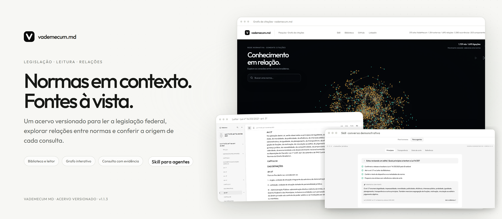
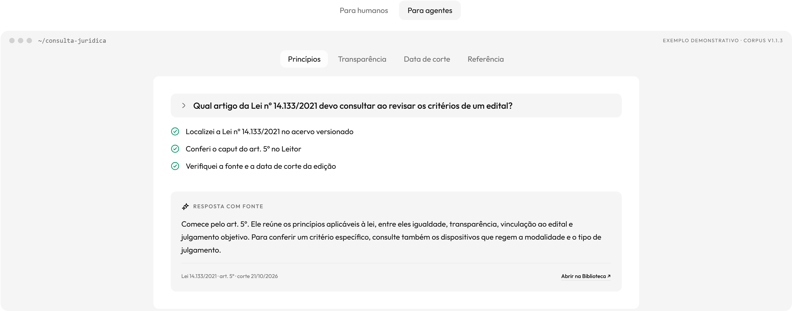
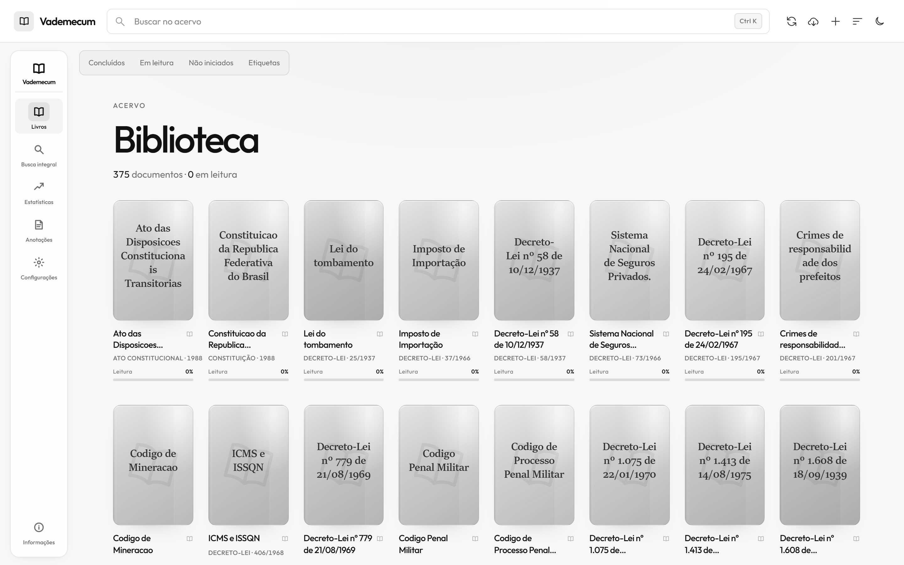
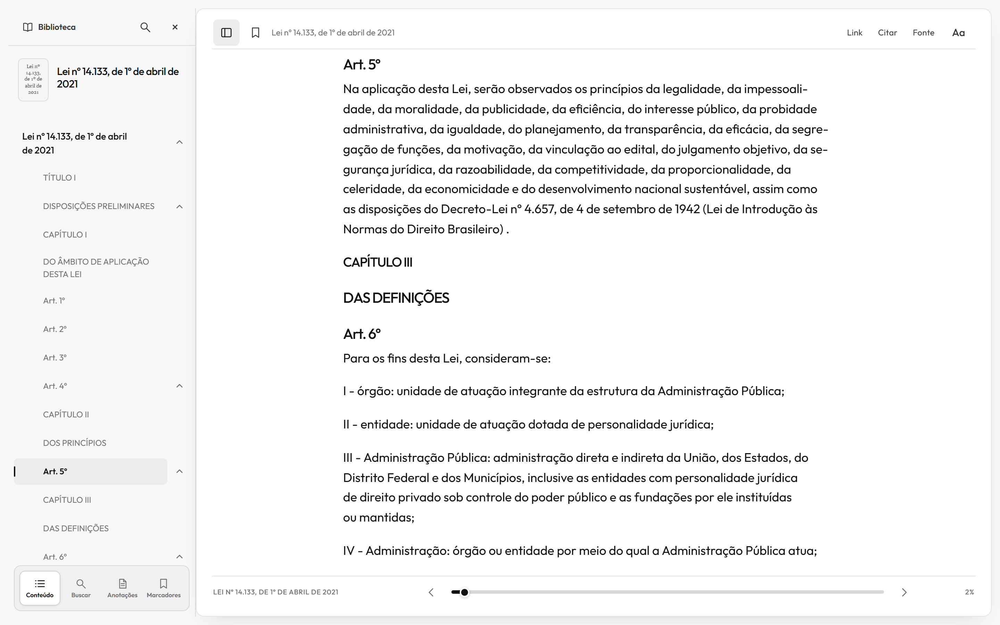
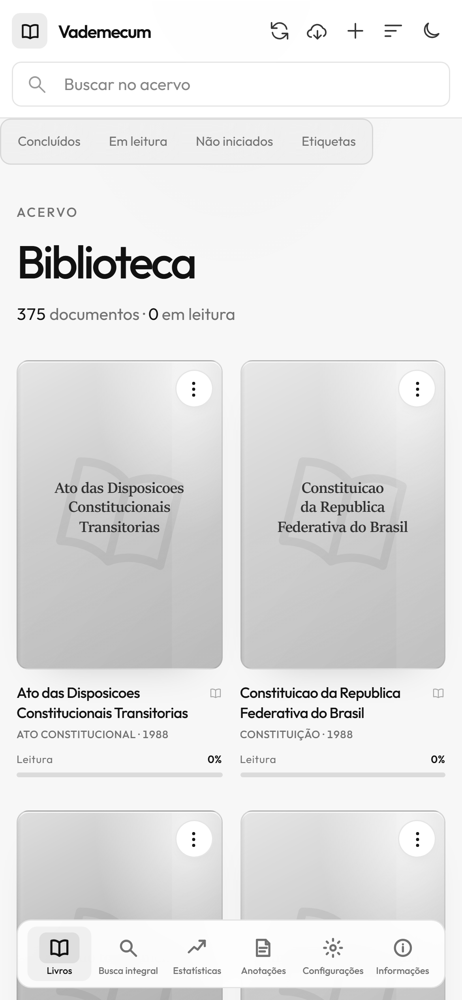
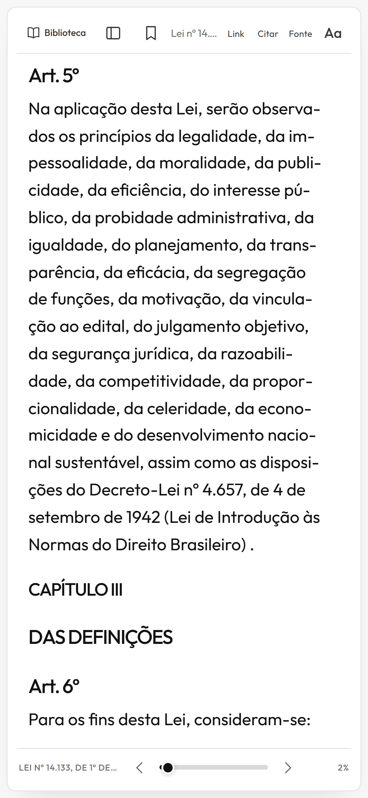

<p align="center">
  
</p>

<h1 align="center">VadeMecum MD</h1>

<p align="center"><strong>Legislação federal, uma skill para agentes e o conhecimento normativo em relação — com fontes à vista.</strong></p>

<p align="center">
  <a href="https://lucmolero.github.io/vademecum-md/">Página inicial</a> ·
  <a href="https://lucmolero.github.io/vademecum-md/biblioteca/">Biblioteca</a> ·
  <a href="https://lucmolero.github.io/vademecum-md/demos/">Demonstrações</a> ·
  <a href="https://github.com/lucmolero/vademecum-md/releases/tag/v1.1.3">Baixar acervo</a>
</p>

<p align="center">
  
</p>

Cada diploma publicado em Markdown tem identidade estável, metadados de
curadoria, data de corte, fonte indicada e informações de proveniência.

> **Snapshot v1.1.3:** 375 diplomas federais · data de corte: 21/10/2026.
> O corte identifica esta coleção; o corpus não é atualizado em tempo real.

## O projeto

O VadeMecum MD reúne texto, leitura e relações normativas em um mesmo acervo.

- **Leitura:** busca no texto integral, navegação por dispositivos, marcadores e anotações.
- **Conhecimento em relação:** grafo interativo que representa citações normativas como uma rede navegável, com busca, nós exploráveis e acesso ao Leitor.
- **Skill para agentes:** instruções de consulta que orientam a recuperação do diploma, a conferência do dispositivo e a resposta com referência e data de corte.
- **Acervo versionado:** Markdown, manifestos e interfaces consultam a mesma release; cada resposta demonstrativa mantém a fonte indicada e os limites do corte visíveis.

A tela completa do grafo está disponível em [`/graph/`](https://lucmolero.github.io/vademecum-md/graph/). Ela representa as relações de citação entre normas e pode ser aberta pelo menu da homepage ou pelos links da Biblioteca.

Concebido e mantido por [Luciano Molero](https://github.com/lucmolero).
O projeto é estático: os dados pessoais de leitura permanecem no navegador.

## Demonstrações e telas

O filme de lançamento (1080p, 1:48) reúne a consulta demonstrativa da skill, a busca na Biblioteca, a conferência de fonte no Leitor e o grafo como representação navegável do conhecimento normativo. As cenas de abertura e transição usam animações vetoriais em código; os clipes mostram a interface real, com mouse, cliques, arraste e pausas para acompanhar cada etapa. A trilha e os sinais sonoros foram sintetizados para este filme. A conversa da homepage é demonstrativa; ela não representa uma resposta ao vivo de um modelo de IA.

- [Assistir às demonstrações](https://lucmolero.github.io/vademecum-md/demos/)
- [Filme completo — skill, Biblioteca, Leitor e grafo do conhecimento](homepage/public/demos/media/vademecum-tour.mp4)
- [Biblioteca e Leitor: localizar a Lei nº 14.133/2021, abrir o art. 5º e conferir a procedência](homepage/public/demos/media/biblioteca-e-leitor.webm)
- [Grafo: busca, arraste, cartão e abertura do Leitor](homepage/public/demos/media/grafo-em-uso.webm)
- [Skill: princípios, transparência, data de corte e referência](homepage/public/demos/media/consultas-para-agentes.webm)

Capturas em alta resolução das telas reais. Selecione uma imagem para abri-la
em tamanho integral.

<p align="center">
  <a href="docs/media/launch/homepage-desktop.png"></a>
  <a href="docs/media/launch/skill-chat.png"></a>
</p>

<p align="center"><sub>Homepage · componente da skill renderizado pela interface real</sub></p>

<p align="center">
  <a href="docs/media/launch/biblioteca-desktop.png"></a>
  <a href="docs/media/launch/leitor-desktop.png"></a>
  <a href="docs/media/launch/grafo-desktop.png"></a>
</p>

<p align="center"><sub>Biblioteca · Leitor · Grafo — desktop</sub></p>

<p align="center">
  <a href="docs/media/launch/biblioteca-mobile.png"></a>
  <a href="docs/media/launch/leitor-mobile.png"></a>
  <a href="docs/media/launch/grafo-mobile.png"></a>
</p>

<p align="center"><sub>Biblioteca · Leitor · Grafo — celular</sub></p>

## Escolha como consultar

| Objetivo | Comece aqui |
| --- | --- |
| **Ler e localizar uma norma** | Use a [biblioteca e o leitor](https://lucmolero.github.io/vademecum-md/biblioteca/) ou o [catálogo](https://lucmolero.github.io/vademecum-md/generated/catalog/). Confira ID, situação do texto, fonte e data de corte. |
| **Consultar com um agente de IA** | Forneça os arquivos ou a release ao agente e use a [skill de consulta jurídica](skills/vademecum-consulta-juridica/SKILL.md). A skill orienta a consulta e a citação; não concede acesso automático ao GitHub. |
| **Integrar em dados ou ferramentas** | Comece por [`manifests/corpus.csv`](manifests/corpus.csv), [`manifests/consumer-contract.json`](manifests/consumer-contract.json) e o [grafo normativo](bases/derived/relacoes/normative-graph.jsonl). Fixe uma release para resultados reproduzíveis. |

## Texto, evidência e camadas derivadas

O Markdown em [`bases/curated/legislacao/federal/`](bases/curated/legislacao/federal/)
é a camada canônica de conteúdo deste projeto. Cada documento identifica a
norma e registra os metadados disponíveis, como fonte, corte, situação,
consolidação e hash.

O leitor web, o catálogo, os índices e as relações ajudam a encontrar e navegar
no corpus. São artefatos derivados e não substituem o texto canônico nem a
publicação oficial. Para verificar uma norma, abra a fonte oficial indicada no
documento.

A release [v1.1.3](https://github.com/lucmolero/vademecum-md/releases/tag/v1.1.3)
inclui o corpus versionado, manifesto, checksums e SBOM. Use o pacote e os
[`SHA256SUMS.txt`](https://github.com/lucmolero/vademecum-md/releases/download/v1.1.3/SHA256SUMS.txt)
para fixar e verificar os arquivos consultados.

## Citar uma consulta

Preserve o diploma, o dispositivo, o ID, a release, a data de corte e a fonte
oficial. Por exemplo:

```text
Código Civil, art. 1º
VadeMecum MD, release v1.1.3, corte 2026-10-21.
ID: br-federal-lei_ordinaria-10406-2002.
Fonte oficial: https://normas.leg.br/?urn=urn:lex:br:federal:lei:2002-01-10;10406
```

## Mapa do repositório

| Caminho | Papel |
| --- | --- |
| [`bases/curated/`](bases/curated/) | Textos canônicos publicados em Markdown. |
| [`bases/derived/`](bases/derived/) | Catálogos, relações e outros artefatos regeneráveis. |
| [`manifests/`](manifests/) | Inventário do corpus, contratos de consumo e dados de release. |
| [`skills/`](skills/) | Instruções portáteis para consulta por agentes. |
| [`site_docs/`](site_docs/) | Fontes do site editorial, que é gerado a partir do corpus. |
| [`homepage/`](homepage/) · [`biblioteca/`](biblioteca/) | Fontes da homepage e do leitor oficial; o workflow as compila junto com o corpus da release. |
| [`tools/`](tools/) · [`tests/`](tests/) | Ferramentas de aquisição, geração e validação; verificações automatizadas. |
| [`docs/`](docs/) | Especificações, arquitetura e políticas do projeto. |

## Escopo e limites

O VadeMecum MD é uma seleção curada de legislação federal, não uma cobertura
integral do Direito brasileiro, publicação oficial ou aconselhamento jurídico.
A situação e a consolidação descrevem os metadados publicados no corte indicado;
confirme a fonte oficial antes de citar ou aplicar uma norma. Relações e estados
incertos não bastam, por si só, para afirmar vigência atual.

## Projeto e governança

- [Metodologia e arquitetura](https://lucmolero.github.io/vademecum-md/architecture/)
- [Limites jurídicos](https://lucmolero.github.io/vademecum-md/legal-limits/)
- [Como contribuir e manter](CONTRIBUTING.md)
- [Política de segurança](SECURITY.md) · [Histórico de versões](CHANGELOG.md)

O código e os materiais autorais seguem a [licença MIT](LICENSE). O escopo da
licença e a exclusão dos textos normativos e materiais de terceiros estão
descritos em [licenças e materiais](LICENSE.md).

## Executar as interfaces

Requer Node.js 22 ou posterior. A partir da raiz:

```sh
npm ci --prefix biblioteca
npm run build --prefix biblioteca
npm ci --prefix homepage
npm run dev --prefix homepage
```

Abra `http://127.0.0.1:8765/`. A Biblioteca usa o corpus e o manifesto deste
checkout por padrão. Os previews usam dados pequenos e isolados; interações
demonstrativas não alteram a biblioteca pessoal.

Para verificar as interfaces:

```sh
npm test --prefix biblioteca
npm run build --prefix homepage
npm run test:graph --prefix homepage
cd homepage
npx playwright install chromium webkit
npm run test:e2e
```

A [documentação da homepage](homepage/README.md) explica a composição do site;
a [documentação da Biblioteca](biblioteca/README.md) detalha leitura, dados locais
e backup. O [guia de contribuição](CONTRIBUTING.md) reúne os validadores do corpus.
