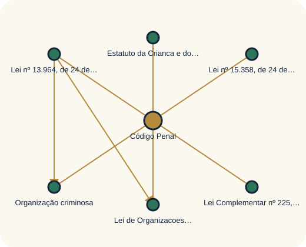

# VadeMecum MD

  <a href="https://lucmolero.github.io/vademecum-md/">
    <picture>
      <source media="(prefers-color-scheme: dark)" srcset="site_docs/assets/logo-lockup-dark.svg">
      <source media="(prefers-color-scheme: light)" srcset="site_docs/assets/logo-lockup.svg">
      
    </picture>
  </a>

  
<strong>Legislação federal brasileira organizada para leitura, consulta e verificação de proveniência.</strong>

  
<a href="https://lucmolero.github.io/vademecum-md/">Leitor web</a> · <a href="https://lucmolero.github.io/vademecum-md/generated/catalog/">Catálogo</a> · <a href="https://lucmolero.github.io/vademecum-md/graph/">Grafo normativo</a> · <a href="https://github.com/lucmolero/vademecum-md/releases/tag/v1.1.2">Release v1.1.2</a>

> **Snapshot publicado:** 375 diplomas · corte temporal 2026-10-21. Consulte a release e os metadados de cada documento antes de reutilizar o conteúdo. O corte identifica esta coleção; não representa atualização em tempo real.

## Encontre uma lei

Para abrir qualquer diploma diretamente como Markdown no GitHub, comece pelo **[índice completo da legislação](docs/INDICE_LEGISLACAO.md)**. Ele lista os documentos canônicos por tipo e ano e oferece atalhos de acesso.

| Coleção | Acesso aos documentos Markdown |
| --- | --- |
| Constituição e atos constitucionais | [Constituição](bases/curated/legislacao/federal/constituicao/) · [Atos constitucionais](bases/curated/legislacao/federal/atos-constitucionais/) |
| Códigos e decretos-lei | [Decretos-lei por ano](bases/curated/legislacao/federal/decretos-lei/) |
| Leis complementares | [Leis complementares por ano](bases/curated/legislacao/federal/leis-complementares/) |
| Leis ordinárias | [Leis ordinárias por ano](bases/curated/legislacao/federal/leis-ordinarias/) |
| Decretos | [Decretos por ano](bases/curated/legislacao/federal/decretos/) |

### Acesso rápido

| Diploma | Texto canônico |
| --- | --- |
| Constituição da República Federativa do Brasil de 1988 | [Abrir Markdown](bases/curated/legislacao/federal/constituicao/1988/constituicao-da-republica-federativa-do-brasil-1988.md) |
| Código Civil — Lei nº 10.406/2002 | [Abrir Markdown](bases/curated/legislacao/federal/leis-ordinarias/2002/lei-ordinaria-10406-2002.md) |
| Código de Processo Civil — Lei nº 13.105/2015 | [Abrir Markdown](bases/curated/legislacao/federal/leis-ordinarias/2015/lei-ordinaria-13105-2015.md) |
| Código Penal — Decreto-Lei nº 2.848/1940 | [Abrir Markdown](bases/curated/legislacao/federal/decretos-lei/1940/decreto-lei-2848-1940.md) |
| Código de Processo Penal — Decreto-Lei nº 3.689/1941 | [Abrir Markdown](bases/curated/legislacao/federal/decretos-lei/1941/decreto-lei-3689-1941.md) |
| Consolidação das Leis do Trabalho — Decreto-Lei nº 5.452/1943 | [Abrir Markdown](bases/curated/legislacao/federal/decretos-lei/1943/decreto-lei-5452-1943.md) |
| Código de Defesa do Consumidor — Lei nº 8.078/1990 | [Abrir Markdown](bases/curated/legislacao/federal/leis-ordinarias/1990/lei-ordinaria-8078-1990.md) |
| Estatuto da Criança e do Adolescente — Lei nº 8.069/1990 | [Abrir Markdown](bases/curated/legislacao/federal/leis-ordinarias/1990/lei-ordinaria-8069-1990.md) |
| Estatuto da Advocacia — Lei nº 8.906/1994 | [Abrir Markdown](bases/curated/legislacao/federal/leis-ordinarias/1994/lei-ordinaria-8906-1994.md) |
| Código Tributário Nacional — Lei nº 5.172/1966 | [Abrir Markdown](bases/curated/legislacao/federal/leis-ordinarias/1966/lei-ordinaria-5172-1966.md) |
| Lei de Licitações — Lei nº 14.133/2021 | [Abrir Markdown](bases/curated/legislacao/federal/leis-ordinarias/2021/lei-ordinaria-14133-2021.md) |

Para pesquisar por nome, número ou artigo, use o [catálogo no GitHub Pages](https://lucmolero.github.io/vademecum-md/generated/catalog/). O leitor oferece páginas formatadas, busca e navegação por dispositivos; os arquivos Markdown acima permanecem acessíveis diretamente no repositório.

No GitHub, este README é uma página Markdown estática. A busca interativa e os controles do leitor estão disponíveis no GitHub Pages.

<!-- BEGIN GENERATED NORMATIVE GRAPH -->

## Explore relações entre as normas

O recorte abaixo parte de **Código Penal** e reflete relações tipadas do grafo publicado (**375 diplomas · 1.841 registros**, incluindo inversas). No README, use os links da tabela para abrir cada texto canônico; para buscar e percorrer vizinhos no grafo completo, abra o [explorador interativo no GitHub Pages](https://lucmolero.github.io/vademecum-md/graph/).

| Origem | Relação registrada | Destino |
| --- | --- | --- |
| [Lei Complementar nº 225, de 8 de janeiro de 2026](bases/curated/legislacao/federal/leis-complementares/2026/lei-complementar-225-2026.md) | altera → | [Código Penal](bases/curated/legislacao/federal/decretos-lei/1940/decreto-lei-2848-1940.md) |
| [Organização criminosa](bases/curated/legislacao/federal/leis-ordinarias/2012/lei-ordinaria-12694-2012.md) | altera → | [Código Penal](bases/curated/legislacao/federal/decretos-lei/1940/decreto-lei-2848-1940.md) |
| [Lei de Organizacoes Criminosas](bases/curated/legislacao/federal/leis-ordinarias/2013/lei-ordinaria-12850-2013.md) | altera → | [Código Penal](bases/curated/legislacao/federal/decretos-lei/1940/decreto-lei-2848-1940.md) |
| [Lei nº 13\.964, de 24 de dezembro de 2019](bases/curated/legislacao/federal/leis-ordinarias/2019/lei-ordinaria-13964-2019.md) | altera → | [Código Penal](bases/curated/legislacao/federal/decretos-lei/1940/decreto-lei-2848-1940.md) |
| [Lei nº 15\.358, de 24 de março de 2026](bases/curated/legislacao/federal/leis-ordinarias/2026/lei-ordinaria-15358-2026.md) | altera → | [Código Penal](bases/curated/legislacao/federal/decretos-lei/1940/decreto-lei-2848-1940.md) |
| [Estatuto da Crianca e do Adolescente](bases/curated/legislacao/federal/leis-ordinarias/1990/lei-ordinaria-8069-1990.md) | altera → | [Código Penal](bases/curated/legislacao/federal/decretos-lei/1940/decreto-lei-2848-1940.md) |
| [Lei nº 13\.964, de 24 de dezembro de 2019](bases/curated/legislacao/federal/leis-ordinarias/2019/lei-ordinaria-13964-2019.md) | altera → | [Organização criminosa](bases/curated/legislacao/federal/leis-ordinarias/2012/lei-ordinaria-12694-2012.md) |
| [Lei nº 13\.964, de 24 de dezembro de 2019](bases/curated/legislacao/federal/leis-ordinarias/2019/lei-ordinaria-13964-2019.md) | altera → | [Lei de Organizacoes Criminosas](bases/curated/legislacao/federal/leis-ordinarias/2013/lei-ordinaria-12850-2013.md) |

*O README do GitHub é estático: o diagrama é uma prévia. Cada nó da tabela abre o Markdown da lei; o Pages oferece busca, filtros por tipo/direção e navegação de vizinhos.*

<!-- END GENERATED NORMATIVE GRAPH -->

## Navegação e proveniência

Cada arquivo Markdown é o texto canônico desta coleção. A página do leitor apresenta o documento para consulta e pode oferecer recursos de navegação; os metadados indicam identificador, fonte, corte temporal e informações de processamento disponíveis.

- [Metodologia e critérios de organização](https://lucmolero.github.io/vademecum-md/methodology/)
- [Fontes documentais](https://lucmolero.github.io/vademecum-md/sources/)
- [Auditoria e limites de validação](https://lucmolero.github.io/vademecum-md/legal-audit/)
- [Manifests e schemas](manifests/)
- [Release e artefatos para uso offline](https://github.com/lucmolero/vademecum-md/releases/tag/v1.1.2)

O grafo reúne relações normativas publicadas como dados estruturados. Consulte os documentos e as fontes correspondentes para avaliar cada relação; a visualização não determina, por si, efeito jurídico.

## Sobre o projeto

O VadeMecum MD organiza legislação federal brasileira em Markdown e publica índices, metadados e ferramentas para leitura e integração. A coleção identificada nesta página contém 375 diplomas no corte de 2026-10-21. A quantidade e o corte descrevem esse snapshot, não garantem completude do ordenamento ou atualização posterior.

## Escopo e uso

Este repositório não é publicação oficial, parecer jurídico ou aconselhamento. A publicação oficial é a referência primária. Confira a fonte, os metadados e a data de corte antes de citar ou reutilizar um texto. Situação jurídica e relações dependem das evidências publicadas para cada documento e release.

O código e os materiais autorais de marca e design seguem a [Licença MIT](LICENSE.md). Textos normativos oficiais e materiais de terceiros permanecem sujeitos ao regime aplicável a cada fonte.

## Projeto e contribuições

- [Como contribuir](CONTRIBUTING.md)
- [Política de segurança](SECURITY.md)
- [Histórico de versões](CHANGELOG.md)
- [Agent Skill para consulta estruturada](skills/vademecum-consulta-juridica/SKILL.md)
- [Arquitetura do projeto](https://lucmolero.github.io/vademecum-md/architecture/)
- [Contrato dos documentos](https://lucmolero.github.io/vademecum-md/contract/)
