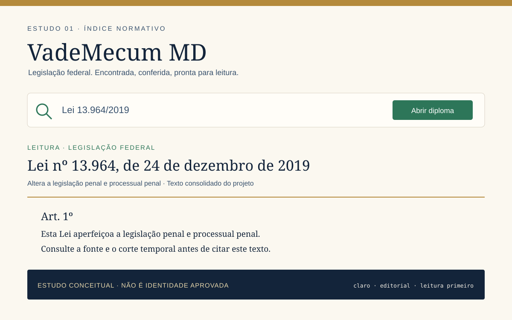
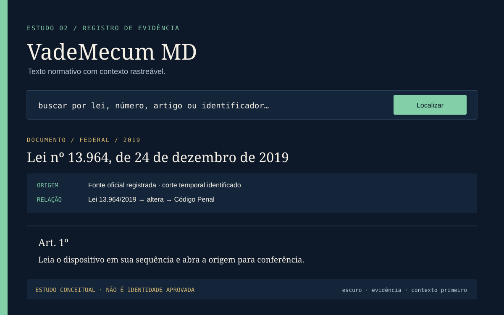
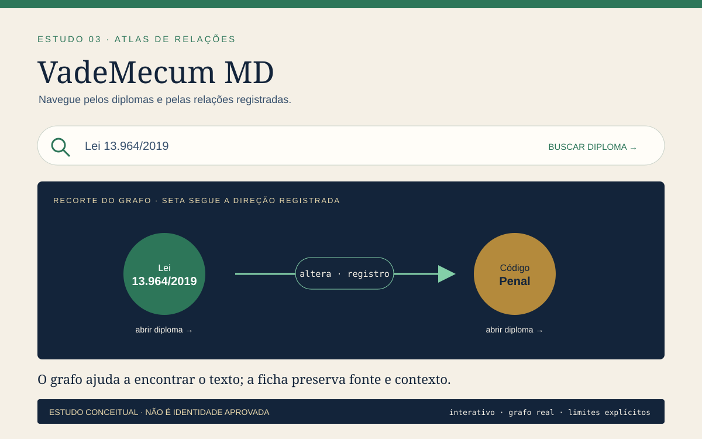

# Estudos de direção visual

**Estado:** estudos comparativos da candidata. A direção Índice normativo foi escolhida como plataforma de produto em 2026-10-22; a seleção ainda precisa de avaliação com usuários antes de ser anunciada como identidade final.

Os três painéis usam a mesma amostra de produto — busca pela Lei 13.964/2019, referência de atualização do Código Penal e leitura de um artigo — para tornar a comparação concreta. Os dados relacionais são demonstrativos do registro publicado e não afirmam, por si só, efeito ou interpretação jurídica. Os SVGs são vetores locais criados para este estudo, sem fontes ou imagens externas.

## 1. Índice normativo

Publicação editorial contemporânea. A hierarquia começa pela tarefa do advogado; o número do diploma e a leitura têm mais peso que ornamentos. A paleta canônica preserva continuidade com o produto atual.

**Pontos para avaliar:** reconhecimento rápido de um leitor legislativo, conforto para leitura longa, diferenciação suficiente de uma editora tradicional e clareza da navegação por tipo/ano.

## 2. Registro de evidência

Uma ficha documental organiza diploma, corte, origem e relação. A estrutura técnica é visível, mas a leitura continua sendo o destino principal; metadados não devem se parecer com indicadores de desempenho.

**Pontos para avaliar:** confiança na proveniência, compreensão dos limites dos metadados, legibilidade em mobile e risco de a interface parecer um dashboard.

## 3. Atlas de relações

O grafo se torna a assinatura visual e uma entrada de navegação. A direção das setas segue os registros `source_id → target_id`; cada nó representa um diploma navegável. A relação ilustrada é um dado do corpus, não uma conclusão jurídica autossuficiente.

**Pontos para avaliar:** utilidade real do grafo para encontrar diplomas, entendimento de direção e tipo, legibilidade da lista alternativa e risco de atribuir ao desenho uma interpretação que seus dados não sustentam.

## Comparação e decisão

| Critério | Índice normativo | Registro de evidência | Atlas de relações |
| --- | --- | --- | --- |
| Encontrar uma lei com rapidez | Hierarquia editorial | Busca dentro da ficha | Exploração por vizinhança |
| Leitura prolongada | Forte potencial | Requer proteger a coluna de texto | Risco de competir com o texto |
| Proveniência visível | Metadados discretos | Protagonista | Exibida junto às arestas |
| Diferenciação | Média | Alta | Alta |
| Risco principal | Parecer uma editora convencional | Parecer uma ferramenta de auditoria | Parecer sugerir efeito jurídico |

Decisão de trabalho para esta candidata: adotar **Índice normativo** como identidade principal e usar o **Registro de evidência** para apresentar proveniência. Manter o grafo como recurso navegável do produto; não adotá-lo como marca principal. Validar clareza, compreensão da direção e limites das relações com usuários antes de declarar a identidade final.

Antes da escolha, revisar estes mesmos contextos em escala real (favicon, README no GitHub, tela mobile, diploma completo e tema escuro), verificar contraste e testar as tarefas com advogados. Registrar decisão, feedback, autoria e licença em [`BRANDING.md`](BRANDING.md) e [`ASSET_INVENTORY.md`](ASSET_INVENTORY.md).
