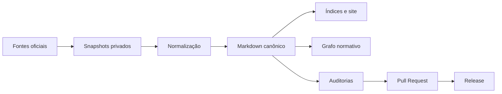

# Arquitetura

O produto separa a fonte normativa dos artefatos derivados:

`bases/curated` é a camada normativa pública. `bases/history` preserva versões,
alterações e evidências. `bases/derived` é regenerável e nunca substitui o
texto canônico.

## Contratos

- cada diploma possui um ID estável e um Markdown próprio;
- o frontmatter descreve identidade, situação, corte, fonte e hashes;
- o grafo referencia somente IDs existentes;
- o site é gerado novamente a partir do corpus;
- uma proposta não altera a branch padrão diretamente.
